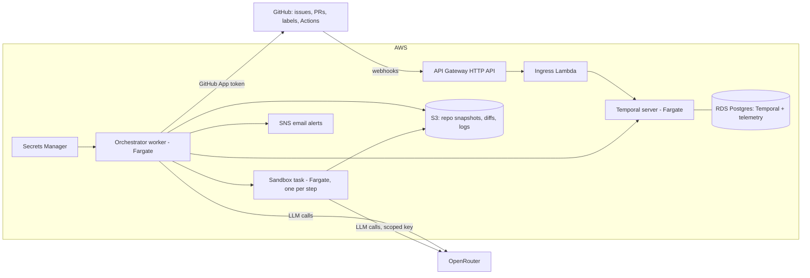

# PRD: Dark Factory

> **Status:** Approved.
> **Author and owner:** Ran Wolf

## 1. Summary

Dark Factory takes a GitHub issue to a merged pull request through a pipeline of AI agents with enforced human gates. Each issue starts a durable Temporal workflow: plan, implement in an isolated sandbox, open a PR, review by a model from a different vendor, wait for CI, wait for human approval where the issue requires it, revise or merge. Every LLM call picks its model through OpenRouter according to a versioned routing policy, and every run records duration, tokens, cost and outcome.

The name comes from lights-out manufacturing: a fully automated factory can run in the dark, because machines need no light and no humans work on the floor. Here the humans stand at the gates.

It is a central software house: one pipeline, configured once, that any number of repositories register with. It runs locally on Docker Compose and in production on AWS, with all infrastructure defined in Terraform and deployed through GitOps.

## 2. Why this project exists

A learning and portfolio project, built in the open. It must demonstrate three technologies end to end on a system with a real problem to solve.

| Area | What the project must demonstrate |
|---|---|
| AI-assisted engineering | Agent loops defined as code; model choice per task through OpenRouter; several reviewed PRs merged per working session. The system builds itself |
| AWS | Deployed and operated on AWS with Terraform and GitOps; each service choice justified in the design write-up |
| Temporal | Long-running, failure-prone processes as Temporal workflows: retries, timeouts, human-in-the-loop signals, bounded loops, recovery from worker loss |

Secondary goals: a stated scale target with a load test (M4).

## 3. Problem and users

- **Primary user:** a single developer (the owner) running several projects and several agent tasks at once.
- **Problem:** every new project needs its agent pipeline rebuilt from scratch. Agents also cannot yet be left to work unattended: there are no guardrails or supervision the developer trusts, so they need babysitting.
- **What the system provides:** one pipeline with explicit, enforced human gates; a full audit trail per run; and the telemetry needed to loosen the gates over time, on evidence.

### Success metrics

Measured on this repository, which is built with the system.

| Metric | Definition | Target |
|---|---|---|
| Human-edit rate | Share of merged agent PRs that contain any commit authored by a human | < 5% |
| Agent lead time | Time from the `agent` label to merge, **excluding** time paused at human gates. Median | < 30 min |
| Redo rate | Share of runs with at least one redo. A **redo** is: the owner rejects or requests changes at a gate (plan or merge), or a merged PR is later reverted. Revision rounds triggered by the automated reviewer or by failing CI are **not** redos; they are tracked separately as revision rounds per run | < 20% at M3; < 5% long term |
| Cost per merged PR | OpenRouter spend per run, from usage data | Tracked; hard cap per run (section 9) |

Time paused at gates is recorded too, without a target.

## 4. Scope

### MVP (M0 to M3)

1. **Repository registration:** a repository joins by installing the GitHub App and adding an entry to the registry file in this repo (GitOps). Per-repo config: default gates, test command, routing overrides.
2. **Issue to PR:** an owner-applied `agent` label starts a run that plans, implements in a sandbox and opens a PR.
3. **Review loop:** cross-vendor automated review, CI wait, bounded revision rounds.
4. **Human gates:** plan and merge gates per issue, enforced; owner approvals and change requests as signals.
5. **Telemetry:** per-run and per-step duration, tokens, cost, model and outcome, queryable and shown in the README demo.

### Later

- `gate:none` (merge with no human in the loop), only once the metrics support it.
- Creating new repositories from an issue in a control repository.
- Parallel runs per repository with conflict handling (merge queue or rebase).
- A self-built inner coding loop replacing the wrapped agent (section 5.5), compared on recorded telemetry.
- Jira adapter; MCP tools for agents; run dashboard; target repositories in other languages.

### Non-goals

- Production hardening beyond what the design write-up discusses (multi-region, formal SLAs, HA Temporal).
- A polished front end. GitHub is the interface; the Temporal UI and a CLI report cover the rest.
- Multi-tenant use. One owner.
- Auto-merge in MVP.

## 5. Design

### 5.1 Human gates and labels

Gates are set per issue by labels. Only the owner may apply trigger and gate labels.

| Label | Effect |
|---|---|
| `agent` | Starts a run for the issue |
| `gate:plan` | Run pauses after planning until the owner approves the plan |
| `gate:merge` | Run pauses before merge until the owner approves the PR |
| `gate:none` | Merge with no human in the loop. **Not in MVP** |

Defaults come from the repository config; labels on the issue override them.

**Approvals:** plan approval and change requests are owner comments on the issue (`/approve`, `/changes <text>`, `/reject`). Merge approval is a GitHub PR review by the owner (Approve or Request changes). Commands from anyone else are ignored and logged.

**Enforcement:**

- Agents never hold GitHub credentials. Sandboxes return a diff; only orchestrator activities talk to GitHub, through a narrow client with no operation for trigger or gate labels.
- Every `labeled` webhook event is checked against the owner allowlist (`sender.login`). An unauthorised trigger or gate label is removed, no run starts or advances, a comment is posted on the issue and an email alert goes out through SNS.
- **Protected paths:** a PR touching `infra/`, `.github/`, the system prompts, the routing policy, the registry or the gate code always requires `gate:merge`, whatever the labels say, and can never use `gate:none`.

### 5.2 Untrusted input: no text from GitHub is ever an instruction

**Rule:** no text that originates on GitHub is ever treated as an instruction. This covers issue titles and bodies, PR descriptions, comments, reviews, commit messages, code and code comments, CI logs, and the output of one agent passed to another.

The issue body is the one place where GitHub text shapes the work: it is the **task description**. It defines what to build, within fixed policy. It can never change rules, tools, permissions, gates or workflow steps.

The guarantee comes from capabilities, not from prompt wording:

1. **One instruction source.** System prompts and policies are versioned files on protected paths (section 5.1). Nothing else is an instruction.
2. **Untrusted-data envelope.** All GitHub text reaches a model inside a delimited block that records its source and author, and the system prompt declares the block's contents to be data.
3. **Agent-to-agent isolation.** The reviewer returns structured output: a verdict enum (`approve`, `changes`, `reject`) plus review data (a list of findings and a sweep), validated against a schema. The orchestrator reads only the verdict field. All review data reaches the implementer only inside the data envelope. No agent's output ever becomes another agent's instructions.
4. **Decisions are code.** Gate transitions, labels and merges are driven only by typed signals: owner labels, owner commands parsed deterministically, and owner PR reviews. Agents have no tool that can affect them, so even a successful injection cannot approve, label or merge.
5. **Owner text only.** Comments and reviews from anyone other than the owner are dropped before any model sees them. The system never reads its own earlier comments back in. The text of an owner's `/changes` command enters as data describing the requested change.
6. **Detection as a tripwire.** A cheap classifier flags injection-like content; the event is recorded in telemetry and raises an alert. Detection is not relied on for safety.
7. **Injection test suite.** CI fixtures plant instructions in issue bodies, PR comments, code comments, CI logs and reviewer output. Pass: no change to any gate, label, tool call or merge, and the attempt is flagged.

### 5.3 Architecture

| Component | Responsibility |
|---|---|
| Ingress Lambda | Verifies the webhook HMAC signature, checks the sender for label and command events, then starts or signals the matching workflow. Talks only to Temporal |
| Temporal server | Self-hosted on Fargate with RDS Postgres as persistence. Temporal UI on demand, reachable only from the owner's IP |
| Orchestrator worker | Runs all workflows and activities: GitHub client, OpenRouter client, sandbox launcher, telemetry writer, alerts |
| Sandbox | One ECS task per implementation step. Pulls the repo snapshot from S3 by presigned URL, runs the coding agent and the tests, uploads the diff. No GitHub or AWS credentials |
| RDS Postgres | Temporal persistence, plus a separate `telemetry` database for runs, steps and costs |
| GitHub App | Short-lived installation tokens, minimum permissions. The repo registry decides which installations are served |

### 5.4 Temporal workflows

| Workflow | Steps and guarantees |
|---|---|
| `IssueRun(repo, issue)` | Load config, then plan, then wait for the `gate:plan` signal if set. Implement in the sandbox, push the branch and open the PR. Automated review: if it requests changes, implement again (max 3 rounds). Wait for CI (signal from `check_suite`, with timeout): on failure, revise within the same round budget. Wait for the `gate:merge` signal if set, then merge and record telemetry. Every external call is an activity with a timeout and retry policy. Human waits have no timeout but send a reminder. A killed worker resumes the run from history |
| `UnauthorisedLabel(event)` | Remove the label, comment, send the SNS alert, record it |
| `Reconcile()` | On session start and on schedule: find open issues with `agent` and no run, start them. Covers webhooks lost while the system was scaled to zero |

Workflow IDs derive from `repo#issue`, so a duplicate webhook cannot start a second run.

### 5.5 Agents and model routing

- **Outer loop (built here):** plan, implement, review, revise, gate, merge, as Temporal workflows. This is the agent loop the project defines and owns.
- **Inner coding loop (MVP):** Aider, run headless in the sandbox, behind a `CodingAgent` interface. Chosen because it supports any model through OpenRouter, works natively with git, and runs in a plain container (no privileged Docker, so it fits Fargate).
- **Inner coding loop (later):** a self-built tool-use loop behind the same interface. Each LLM call and each tool execution is an activity; long histories use continue-as-new. Compared against Aider on recorded telemetry.
- **Routing policy:** `routing.yaml`, versioned, mapping task type to model:

| Task | Tier | Rule |
|---|---|---|
| Plan | Frontier | Strongest reasoning model within the per-run cap |
| Implement | Strong coding model | Through Aider |
| Review | Frontier, different vendor | Never the same vendor as the implementer. Rotation includes OpenAI and Google models |
| Triage, CI log summary, commit messages | Small, cheap | Lowest cost that passes |

Every call records model, tokens and cost from OpenRouter usage data. A run stops and comments on the issue when it hits the per-run cap.

### 5.6 Infrastructure, Terraform and GitOps

- **Location:** `infra/` in this repository. Convention: infrastructure that belongs to a single application lives with it, so code and infra change in one reviewed PR. A separate repository suits shared platform infrastructure, which this is not.
- **Layout:** `infra/bootstrap` (state bucket, GitHub OIDC provider, IAM roles; applied once by hand), `infra/modules/*`, `infra/envs/prod`.
- **State:** S3 backend with native lockfile locking (Terraform 1.10+).
- **Pipeline (GitHub Actions, OIDC, no long-lived AWS keys):**
  - PR: `fmt`, `validate`, `tflint`, then `plan` with a read-only role, posted as a PR comment.
  - Merge to `main`: build images, push to ECR tagged with the commit SHA, then `apply` with the apply role. The apply role trusts only `refs/heads/main`.
- **Git is the source of truth** for infrastructure, image versions, the routing policy, the repo registry and gate defaults.
- **Scale to zero:** `session-up` and `session-down` workflows (manual dispatch) set ECS desired counts and start or stop RDS. `Reconcile` runs on `session-up`.
- **Local:** Docker Compose with the Temporal dev server, Postgres, the worker and a local Docker sandbox. Webhooks are forwarded with `gh webhook forward`.

### 5.7 Stack

Python 3.14, Temporal Python SDK (`temporalio`), Aider, Terraform, GitHub Actions, Docker. Lint and type checks (ruff, mypy) and tests (pytest, Temporal test environment with time skipping) on every PR.

## 6. Development workflow

Part of the deliverable: the repository shows how it was built.

- **Tracker:** GitHub Issues and Projects.
- **Bootstrapping:** until M2, the same loop runs by hand with coding agents. From M2, the project's own issues run through Dark Factory.
- **Session target:** several reviewed PRs merged per working session.
- **Record:** `docs/ai-workflow.md` logs what worked, what failed, what the models got wrong, and changes to `routing.yaml` with their reasons.

## 7. Scale and performance

MVP: one run per repository at a time.

M4 target (proposal): 50 issues labelled within one minute across 5 repositories, with a stub LLM provider so the test costs nothing. Pass: no lost or duplicated runs, every run completes or parks at its gate, and the orchestrator overhead per step is reported at p50 and p95.

## 8. Milestones

| # | Milestone | Exit criteria |
|---|---|---|
| M0 | Foundations | Repo with this PRD, `.gitattributes` enforcing LF (`* text=auto eol=lf`), CI, Docker Compose with the Temporal dev server, GitHub App created, `routing.yaml` v1, registry file. Own issues run through the manual agent loop |
| M1 | Happy path, local | Owner-labelled issue → workflow → plan → Aider in a local sandbox → PR opened. Timeouts and retries on every activity; a killed worker resumes the run. Idempotent workflow IDs |
| M2 | Review, gates, telemetry | Cross-vendor review, CI wait, bounded revisions, plan and merge gates, owner commands, unauthorised-label handling, protected paths, telemetry tables, per-run cost cap, untrusted-input policy with the injection test suite passing in CI. The project's own issues now run through it |
| M3 | On AWS, documented | Terraform `bootstrap` and `prod` applied through the GitOps pipeline. Fargate services, sandbox tasks, API Gateway and Lambda ingress, RDS, S3, Secrets Manager, SNS, budget alarm, session up/down, `Reconcile`. README with the demo GIF, run history and telemetry; design write-up |
| M4 | Scale (stretch) | Parallel runs with conflict handling, load test (section 7), run dashboard |
| M5 | Extensions (later) | Self-built inner loop compared with Aider, `gate:none`, repo creation from issues, Jira adapter, MCP tools |

## 9. Budget and cost constraints

| Item | Budget |
|---|---|
| AWS | ~$20 a month, scaled to zero between sessions. Budget alarm at $60 |
| OpenRouter | $50 a month; hard cap $5 per run |

Raising a cap needs the owner's approval.

**Cost traps the design must avoid:**

| Trap | Cost (approx., us-east-1) | Design response |
|---|---|---|
| NAT Gateway | ~$33 a month plus data processing | Public subnets with public IPs for tasks that need egress; Lambda reaches only Temporal inside the VPC |
| Application Load Balancer | ~$16+ a month | API Gateway HTTP API plus Lambda for ingress |
| VPC interface endpoints | ~$7 a month each per AZ | Not used; worker reaches AWS APIs over its public IP |
| Public IPv4 addresses | ~$3.60 a month each, always on | Scale to zero stops them |
| RDS left running | Restarts automatically after 7 days stopped | Scheduled `session-down` re-check |
| CloudWatch Logs with no retention | Grows forever | Retention set in Terraform (14 days) |
| Orphaned sandbox tasks | Billed per second until stopped | Hard task timeout; `Reconcile` stops orphans |
| Temporal Cloud | $100 a month minimum | Self-hosted |

## 10. Risks

| Risk | Mitigation |
|---|---|
| AWS arrives late in the window | Everything runs locally first; AWS only at M3 |
| Agent-authored code runs in CI with access to secrets | Protected paths force `gate:merge`; the PR role is read-only; the apply role trusts only `main` |
| Prompt injection through any GitHub text, including between agents | Untrusted-input policy (section 5.2): no GitHub text is an instruction, decisions are code, only owner text is ingested, injection test suite in CI. Agents have no credentials; the sandbox gets only a scoped OpenRouter key with a spend limit |
| Sandbox egress is open (no NAT, no firewall) | Security group allows only 443 outbound; no credentials in the sandbox to exfiltrate. Revisit after the MVP |
| Self-hosted Temporal operations | Single node, managed Postgres, pinned versions. Temporal Cloud is the fallback if M3 slips |
| Costs | Caps in section 9, budget alarm, scale to zero |

## 11. Demo

The README shows a GIF of one full run from issue to merge, the run history in the Temporal UI, and telemetry per run and per step (duration, tokens, cost, model, outcome, revision rounds, redos).

## 12. Open questions

None blocking. To revisit at M2: the concrete models in `routing.yaml`, and the M4 scale target.
